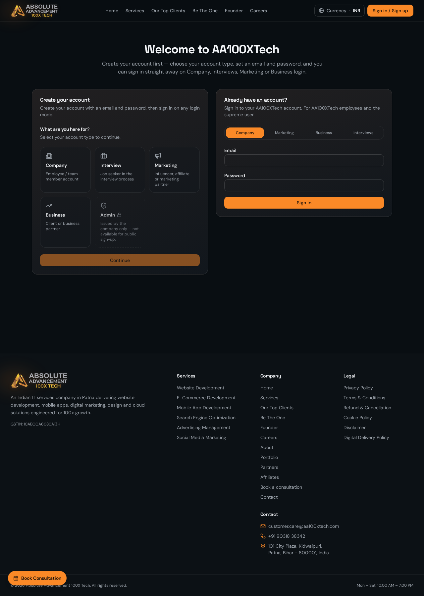
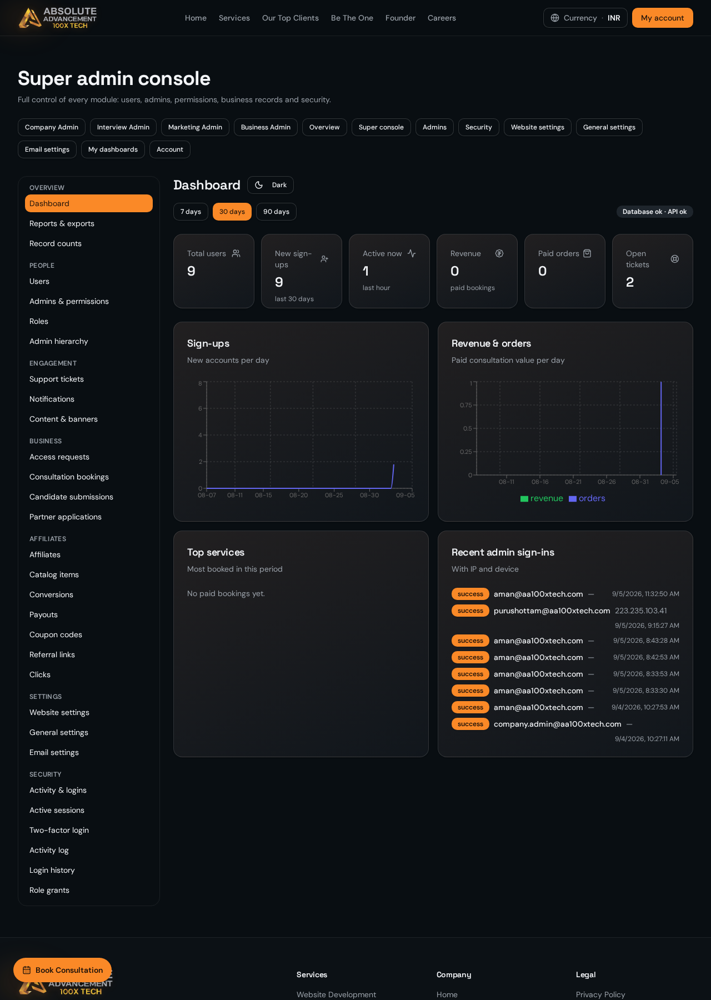
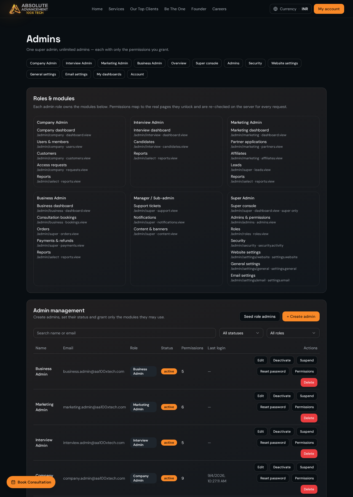
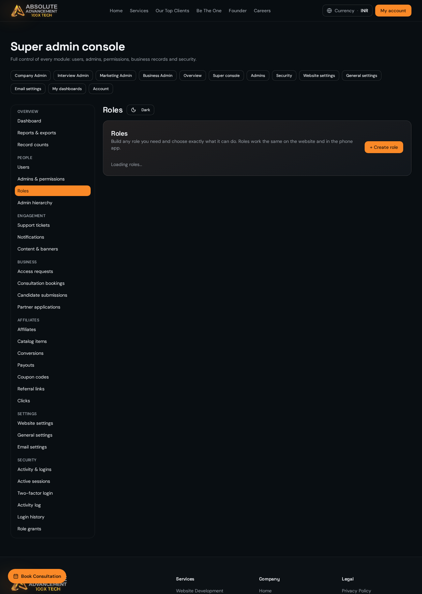
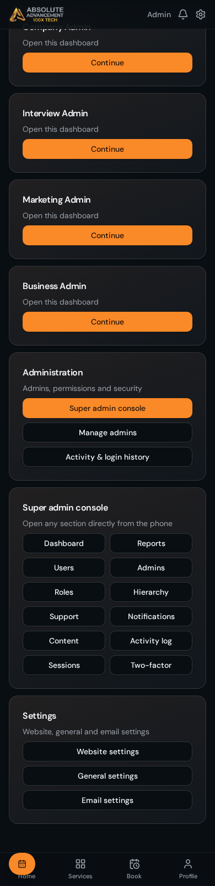

# AA100XTech — Absolute Advancement 100X Tech

**Current setup:** Next.js App Router 16.4.6, React 19, TypeScript, npm, Node.js 20.9+. The older architecture notes below predate parts of the Next.js migration. For the new workspace, follow [AA100XTech Partner Workspace — Setup, Login & Admin Panel Guide](#aa100xtech-partner-workspace--setup-login--admin-panel-guide) below and its explicit verification statuses.

Marketing + operations website for **Absolute Advancement 100X Tech** (AA100XTech), an IT / digital
engineering studio based in Patna, India. The site presents services, pricing, portfolio, careers and
a partner program, and it runs three real transactional systems:

1. **Consultation booking with Razorpay payments** (server-priced orders + signature verification)
2. **Approval-based account system** (supreme admin issues credentials; employees / customers / job seekers sign in)
3. **Form intake** (partner applications, candidate task submissions with file upload, access requests)

Everything is one full-stack app. Current server logic runs in Next.js route handlers and the existing allowlisted RPC transport. Older TanStack route components are retained behind native App Router pages.

---

## 1. Technology Stack

| Layer | Technology |
| --- | --- |
| Framework | Next.js 16.4.6 App Router, React 19.2.4 |
| Build tool | Next.js webpack via `scripts/next.cjs` |
| Language | TypeScript |
| Styling | Tailwind CSS v4 (`src/styles.css`, semantic tokens) |
| UI kit | shadcn-style components on Radix UI (`src/components/ui/*`), `lucide-react` icons |
| Data fetching | TanStack Query v5 |
| Toasts | `sonner` |
| Validation | `zod` (server), hand-written validators (client) |
| Backend logic | Native Next route handlers plus local `src/lib/backend/server.ts` / allowlisted RPC |
| Database / Auth / Storage | Supabase (Lovable Cloud) |
| Payments | Razorpay Orders API + Razorpay Checkout JS |
| Exchange rates | `open.er-api.com` (public REST) |
| Deployment | Next.js-compatible hosting; preserve the Lovable-connected Git history |

Verification tooling includes TypeScript, ESLint, Node tests, isolated PostgreSQL (PGlite) and Playwright. Run the scripts in `package.json`; current Partner Workspace setup and limits are documented in the guide below.

---

## 2. Feature List (what actually exists)

**Public site**
- Home page: hero + animated stat counters, trusted-by logo marquee, services grid, marketing plans,
  website plans, deliverables table, technology & services switcher, why-us section.
- Services listing (`/services`) and per-service detail pages (`/services/$slug`) including AI /
  real-estate services with embedded video demos.
- Portfolio, About, Contact (with FAQ accordion).
- Careers: India cohort (`/careers`), London cohort (`/careers/london`), candidate task submission
  form with file upload (`/careers/apply`).
- Influencer / partner program with a 30-level ladder (`/partners`) and application form (`/partners/apply`).
- Legal pages: privacy, terms, refund, cookies, disclaimer, shipping/digital delivery.
- Global currency selector — live FX conversion of displayed prices, persisted in `localStorage`.
- Floating "Book Consultation" button on every page (links to `/consultation`).
- Responsive layout throughout (Tailwind breakpoints), dark "engineering studio" theme.

**Consultation & payments**
- Dedicated `/consultation` page: hero, stats, why-consult, services grid, process, standard plans,
  premium plans, comparison table, who-it's-for, FAQ, final CTA, sticky CTA.
- Booking modal (global provider) with plan selection → details form → summary → Razorpay checkout →
  success / failed / cancelled screens.
- Server-side order creation with server-derived price, signature verification, duplicate-payment
  protection, and payment-failure marking.

**Accounts / internal**
- Supreme-admin bootstrap, access requests, approval that provisions Supabase auth users.
- Roles: `supreme_admin`, `employee`, `customer`, `job_seeker` (separate `user_roles` table).
- Authenticated area: dashboard (incl. forced password change), team directory with tenure and
  target progress, admin console for approving/rejecting requests and sharing issued credentials via
  prefilled email / SMS / WhatsApp links.

**Contact form:** the `/contact` form is presentational — it simulates submission with a timeout and
shows a success toast. It does **not** persist or email anything.

---

## 3. Project Structure

```
/
├── src/
│   ├── routes/                    # file-based routes (URLs) — see §7
│   │   ├── __root.tsx             # app shell: providers, header, footer, meta
│   │   ├── index.tsx              # /
│   │   ├── consultation.tsx       # /consultation
│   │   ├── services.index.tsx     # /services
│   │   ├── services.$slug.tsx     # /services/:slug
│   │   ├── careers.*.tsx          # /careers, /careers/london, /careers/apply
│   │   ├── partners.*.tsx         # /partners, /partners/apply
│   │   ├── auth.tsx               # /auth (sign in + admin bootstrap)
│   │   ├── request-access.tsx     # /request-access
│   │   ├── _authenticated/        # gated subtree (route.tsx guard)
│   │   │   ├── route.tsx  dashboard.tsx  team.tsx  admin.tsx
│   │   └── <legal pages>.tsx
│   ├── components/                # app components (see §5)
│   │   └── ui/                    # shadcn/Radix primitives — do not hand-edit
│   ├── data/                      # static typed content (plans, services, pricing, legal, …)
│   ├── lib/                       # server functions, schemas, server-only helpers, utils
│   ├── hooks/                     # use-session, use-mobile
│   ├── integrations/supabase/     # AUTO-GENERATED clients, types, auth middleware
│   ├── assets/                    # logo assets
│   ├── router.tsx                 # router factory + QueryClient context
│   ├── start.ts                   # server/function middleware registration
│   ├── server.ts                  # SSR fetch entry with error normalisation
│   ├── routeTree.gen.ts           # GENERATED — never edit
│   └── styles.css                 # Tailwind v4 theme tokens
├── supabase/config.toml           # managed backend config
├── public/                        # static files (robots.txt, favicon)
├── vite.config.ts
├── package.json
└── .env                           # local env values (never commit real secrets)
```

Folder intent:
- `src/routes` — one file per URL; TanStack Router generates `routeTree.gen.ts` from it.
- `src/data` — all copy/pricing lives here as typed constants so pages stay presentational.
- `src/lib` — `*.functions.ts` are client-callable RPC endpoints; `*.server.ts` are server-only
  helpers (blocked from the client bundle by filename).
- `src/integrations/supabase` — generated; `client.ts` (browser, RLS), `client.server.ts`
  (`supabaseAdmin`, bypasses RLS), `auth-middleware.ts` (`requireSupabaseAuth`), `types.ts`.

---

## 4. Important Files

### `src/routes/__root.tsx`
- **Purpose:** app shell for every page. Sets base meta/fonts/favicon, mounts providers.
- **Contents:** `RootShell`, `RootComponent`, `NotFoundComponent` (404), `ErrorComponent` (error boundary + `reportLovableError`).
- **Dependencies:** `QueryClientProvider`, `CurrencyProvider`, `ConsultationProvider`, `SiteHeader`, `SiteFooter`, `Toaster`.
- **Used by:** every route.

### `src/components/consultation-booking.tsx`
- **Purpose:** the entire booking + payment UX and the global "open booking modal" API.
- **Exports:** `ConsultationProvider`, `useConsultationBooking()`.
- **Internal:** `loadRazorpay`, `validate`, `proceedToPayment`, `payNow`, `setField`, `reset`,
  `PlansStep`, `PlanCard`, `Field`, `NativeSelect`, `Row`, `FloatingButton`.
- **Dependencies:** `src/data/consultations.ts`, `src/lib/consultations.functions.ts`, Razorpay Checkout script, `sonner`.
- **Used by:** `__root.tsx` (provider) and `/consultation` (calls `open(planId)`).

### `src/lib/consultations.functions.ts`
- **Purpose:** the three payment RPC endpoints (server functions).
- **Exports:** `createConsultationBooking`, `verifyConsultationPayment`, `markConsultationPaymentFailed`.
- **Dependencies:** `consultations.schemas.ts`, `consultations.server.ts`, `supabaseAdmin` (dynamically imported inside handlers).
- **Used by:** `consultation-booking.tsx`.

### `src/lib/consultations.server.ts`
- **Purpose:** server-only Razorpay layer.
- **Exports:** `generateBookingId`, `createRazorpayOrder`, `verifyRazorpaySignature`, `fetchRazorpayPayment`.
- **Internal:** `credentials()`, `normalizeSecretValue()`, `readRazorpayError()`.

### `src/lib/consultations.schemas.ts`
- Zod schemas: `consultationBookingSchema`, `consultationPaymentVerificationSchema`, `consultationPaymentFailureSchema`.

### `src/data/consultations.ts`
- **Purpose:** single source of truth for plans and pickers.
- **Exports:** `consultationPlans`, `getConsultationPlan(id)`, `consultationServices`, `meetingPlatforms`, `timeZones`, types `ConsultationPlan` / `ConsultationCategory`.

### `src/lib/accounts.functions.ts`
- Server functions for the account system: `getBootstrapStatus`, `bootstrapSupremeAdmin`,
  `getMyAccount`, `listAccessRequests`, `listMembers`, `approveAccessRequest`,
  `rejectAccessRequest`, `listTeam`, `updateTeamMember`. All except the first two use
  `.middleware([requireSupabaseAuth])`.

### `src/lib/rates.functions.ts` / `rates.server.ts`
- `getExchangeRates` server function → `loadRates()` fetches INR-based rates from `open.er-api.com` with an in-memory cache.

### `src/components/currency-provider.tsx`
- `CurrencyProvider`, `useCurrency()`, `<Price value />`. Reads/writes the chosen currency in `localStorage`, fetches rates through TanStack Query, converts INR strings for display only.

### `src/start.ts` / `src/server.ts`
- `start.ts` registers `errorMiddleware`, `createCsrfMiddleware` (server-fn CSRF protection) and the
  client-side `attachSupabaseAuth` function middleware (attaches the bearer token to protected server fns).
- `server.ts` wraps the SSR handler and converts swallowed 5xx JSON errors into a rendered error page.

### `src/integrations/supabase/*` (generated — do not edit)
- `client.ts` browser client, `client.server.ts` `supabaseAdmin`, `auth-middleware.ts` `requireSupabaseAuth`, `types.ts` DB types, `auth-attacher.ts`.

---

## 5. Frontend Architecture

- **Entry / shell:** `src/router.tsx` builds the router with a `QueryClient` in context;
  `src/routes/__root.tsx` renders `<HeadContent />`, header, `<Outlet />`, footer, `<Toaster />`.
- **Routing:** file-based. `_authenticated/route.tsx` guards its subtree; `$slug` is a dynamic segment.
- **State:** local React state per component. Two cross-cutting React contexts:
  `ConsultationContext` (exposes `open(planId?)`) and the currency context. Server data is fetched
  with TanStack Query (`getExchangeRates`) or direct server-function calls in effects/handlers.
- **API calls:** typed RPC — importing a server function and calling `fn({ data })` performs the HTTP
  request. Supabase browser client is used directly for public inserts and storage uploads.
- **Forms:** uncontrolled `FormData` forms (careers, partners, request-access, contact) and a fully
  controlled form object for the booking modal.
- **Modals:** Radix `Dialog` for the booking flow; sheets for mobile nav.
- **Loading / errors:** boolean flags (`creating`, `paying`, `submitting`) drive spinner labels;
  errors surface as `toast.error` plus inline field messages; route-level error/404 components live in `__root.tsx`.
- **Responsive:** Tailwind `sm/md/lg` grids everywhere; `useIsMobile` where behaviour differs.
- **Animations:** CSS transitions/utility classes (`glow-ring`, gradient blobs), animated stat counters.

---

## 6. Home Page Flow (`/`)

Sections rendered by `HomePage`: `Hero`, `TrustedBy`, `ServicesSection`, `MarketingSection`,
`WebPlansSection`, `DeliverablesSection`, `TechnologyStack`, `WhyUsSection`.

| Element | Behaviour |
| --- | --- |
| Hero "Start your project" | `<Link to="/contact">` |
| Hero "View our work" | `<Link to="/portfolio">` |
| Services / plans CTAs | `<Link to="/services">`, `<Link to="/contact">` |
| Why-us CTA | `<Link to="/about">` |
| Technology switcher | client-side category state, no navigation |
| Floating **Book Consultation** button | `<Link to="/consultation">` (rendered globally by `FloatingButton` inside `ConsultationProvider`) |

```
Home Page
   ↓ click "Book Consultation"
/consultation  (full page, no modal yet)
```

---

## 7. Consultation Page (`/consultation`)

Route file: `src/routes/consultation.tsx`, own `head()` metadata.

Sections: `Hero` → `Stats` → `WhyConsult` → `ServicesGrid` → `Process` → `StandardPlans` →
`PremiumPlans` → `Comparison` → `WhoFor` → `Faq` (Radix accordion) → `FinalCta` → `StickyCta`.

Hero buttons call `scrollToPlans()` which scrolls to `#plans`. Plans come from
`consultationPlans` and are split by `category`.

| Plan (`id`) | Category | Duration | Price (INR) | Button |
| --- | --- | --- | --- | --- |
| Quick Consultation (`quick`) | standard | 15 minutes | ₹2,500 | Book Now |
| Standard Consultation (`standard`) | standard | 30 minutes | ₹5,000 | Book Now |
| Professional Consultation (`professional`) | standard | 1 hour | ₹10,000 | Book Now |
| Premium Strategy Session (`premium`) | premium | 1.5 hours | ₹20,000 | Book Premium |
| Enterprise Premium Consultation (`enterprise`) | premium | 2 hours | ₹30,000 | Book Enterprise |
| Executive Consultation (`executive`) | premium | 3 hours | ₹50,000 | Book Executive |

The comparison table repeats these durations and prices. Layout is 1/2/3 columns responsive.

---

## 8. "Book Now" Function

```
User clicks Book Now / Book Premium / Book Enterprise / Book Executive
        ↓  PlanCard onBook  →  open(plan.id)
ConsultationProvider.open(id)
        ↓  setIsOpen(true); setPlanId(id); setStep("details")
Radix Dialog opens directly on the Booking Details step
        ↓  plan = getConsultationPlan(planId)
Plan name, duration and price rendered read-only in the form
```

- **Component handling the click:** `PlanCard` in `src/routes/consultation.tsx`.
- **Function called:** `open` from `useConsultationBooking()` (context value memoised in `ConsultationProvider`).
- **State updated:** `isOpen`, `planId`, `step`.
- Opening the modal with no id (e.g. via the in-modal "Change Plan") sets `step="plans"` and renders
  `PlansStep`, whose `onSelect` sets `planId` and moves to `details`.

---

## 9. Booking Form Fields

All fields live in the controlled `form: BookingForm` state; `setField(key, value)` updates a field
and clears that field's error.

| Field | Type | Required | Validation |
| --- | --- | --- | --- |
| Full Name | text | yes | ≥ 2 chars after trim |
| Company Name | text | no | none (sent as `""` if blank) |
| Email Address | email | yes | regex `^[^\s@]+@[^\s@]+\.[^\s@]{2,}$` |
| Phone Number | text | yes | regex `^[+\d][\d\s()-]{5,19}$` |
| Country | text | yes | ≥ 2 chars (defaults to "India") |
| Service Required | select (`consultationServices`) | yes | must be non-empty; re-checked server-side |
| Selected Consultation Plan | read-only input | — | derived from `plan` |
| Consultation Duration | read-only input | — | derived from `plan` |
| Preferred Date | date | yes | `YYYY-MM-DD` and must not be in the past |
| Preferred Time | time | yes | `HH:MM` |
| Time Zone | select (`timeZones` + detected zone) | yes | non-empty; defaults to `Intl` detected zone |
| Meeting Platform | select (`meetingPlatforms`) | yes | non-empty; defaults to Google Meet |
| Project Description | textarea | yes | ≥ 10 chars |

Submitting runs `proceedToPayment()`.

---

## 10. Form Validation

- **Client:** `validate()` inside `ConsultationProvider` builds an `errors` object keyed by field name;
  messages render under each `Field`. If invalid, a `toast.error("Please fix the highlighted fields.")`
  is shown and no request is made.
- **Server:** `consultationBookingSchema` (zod) re-validates every field with length/format bounds
  (`.inputValidator`), and the handler additionally checks that `planId` exists and that `service`
  and `meetingPlatform` are members of the allow-lists.

---

## 11. Booking Data Flow

```
Booking form (controlled state)
   ↓ validate()
createConsultationBooking({ data })      ← RPC over HTTP (CSRF-protected)
   ↓ zod parse + allow-list checks
plan lookup → amount = plan.price * 100 (paise)
   ↓
Razorpay Orders API  → order_id
   ↓
supabaseAdmin.insert into consultation_bookings (PENDING / PENDING)
   ↓
{ bookingId, orderId, amount, currency, keyId } → frontend state `order`
   ↓ step = "summary"
```

---

## 12. Backend Architecture

There is no standalone server process. Request path:

```
Browser
  ↓  server-function call (or SSR request)
src/server.ts (SSR fetch wrapper, 5xx normalisation)
  ↓
src/start.ts middleware: errorMiddleware → csrfMiddleware
  ↓  (protected fns) requireSupabaseAuth  → context.supabase / userId
createServerFn .inputValidator(zod) → .handler()
  ↓
server-only helpers (*.server.ts) / supabaseAdmin / Razorpay REST
  ↓
Supabase Postgres
  ↓
JSON response
```

- **Auth:** Supabase Auth; the client middleware `attachSupabaseAuth` puts the bearer token on
  protected calls; `requireSupabaseAuth` rejects unauthenticated ones with 401.
- **Privileged access:** `supabaseAdmin` (service role) is dynamically imported inside handlers only.
- **Error handling:** handlers throw `Error` with user-safe text; details go to `console.error`.

---

## 13. API Documentation (server functions)

These are RPC endpoints, not hand-written REST routes. No `src/routes/api/*` files exist.

**`createConsultationBooking`** — POST, auth: none
- Request: `planId, fullName, companyName?, email, phone, country, service, preferredDate, preferredTime, timezone, meetingPlatform, projectDescription`.
- Response (success): `{ ok: true, bookingId, orderId, amount, currency, keyId, planName, duration }`.
- Response (gateway problem): `{ ok: false, error, code }` where code ∈ `CONFIGURATION_MISSING | CONFIGURATION_INVALID | INVALID_CREDENTIALS | GATEWAY_UNAVAILABLE | INVALID_GATEWAY_RESPONSE`.
- Throws: invalid plan, invalid service/platform, DB insert failure, zod validation error.

**`verifyConsultationPayment`** — POST, auth: none
- Request: `bookingId, razorpayOrderId, razorpayPaymentId, razorpaySignature`.
- Response: `{ ok: true, bookingId, paymentId, duplicate }`.
- Throws: booking not found, order mismatch, bad signature (also marks FAILED), payment not captured/authorized, amount or currency mismatch, DB update failure.

**`markConsultationPaymentFailed`** — POST, auth: none
- Request: `bookingId`. Sets `payment_status = FAILED` unless already `PAID`. Response `{ ok: true }`.

**`getExchangeRates`** — GET, auth: none. Returns cached INR-based rates.

**Account functions** (`src/lib/accounts.functions.ts`): `getBootstrapStatus` (GET, public),
`bootstrapSupremeAdmin` (POST, public but refuses once an admin exists), and
`getMyAccount`, `listAccessRequests`, `listMembers`, `approveAccessRequest`, `rejectAccessRequest`,
`listTeam`, `updateTeamMember` — all authenticated via `requireSupabaseAuth`.

Direct-from-browser Supabase writes (RLS enforced): `partner_applications` insert
(`/partners/apply`), `candidate_submissions` insert + `candidate-uploads` storage upload
(`/careers/apply`), `access_requests` insert (`/request-access`), `profiles` update
(`/dashboard` password-change flag).

---

## 14. Database (Supabase Postgres)

Tables (from `src/integrations/supabase/types.ts`): `consultation_bookings`, `access_requests`,
`profiles`, `user_roles`, `partner_applications`, `candidate_submissions`.
Function: `has_role(...)` (security definer, used by RLS policies).
Storage bucket: `candidate-uploads`.

**`consultation_bookings`** — one row per booking attempt.
Fields: `id`, `booking_id` (human key `CONS-XXXXXXXXXX`), `customer_name`, `company_name`, `email`,
`phone`, `country`, `service`, `plan_id`, `consultation_plan`, `consultation_type`, `duration`,
`amount` (rupees), `currency`, `preferred_date`, `preferred_time`, `timezone`, `meeting_platform`,
`project_description`, `razorpay_order_id`, `razorpay_payment_id`, `razorpay_signature`,
`payment_status`, `booking_status`, `created_at`, `updated_at`.
Written only by the payment server functions via `supabaseAdmin`.

**`profiles`** — account records (name, username, email, phone, joined date, target metrics,
`must_change_password`). Used by dashboard, team directory, admin console.

**`user_roles`** — `user_id` + `role` (`supreme_admin | employee | customer | job_seeker`) kept in a
separate table so roles can never be self-escalated from a profile row.

**`access_requests`** — public sign-up requests awaiting supreme-admin approval.

**`partner_applications`** — influencer/partner ladder applications.

**`candidate_submissions`** — candidate task briefs: name, email, phone, role, task title, hours,
availability, expected cost, deliverables, portfolio URL, `file_path` into `candidate-uploads`.

---

## 15. Razorpay Payment System

```
User clicks "Pay with Razorpay ₹X"        (payNow)
        ↓ loadRazorpay() injects checkout.razorpay.com/v1/checkout.js
Frontend already holds order from createConsultationBooking
        ↓ (order was created earlier by "Proceed to Payment")
Backend had: validated input → looked up plan → amount = plan.price * 100
             → POST https://api.razorpay.com/v1/orders (Basic auth)
             → verified returned id/amount/currency
             → inserted booking as PENDING
        ↓
new window.Razorpay({ key, order_id, amount, currency, prefill, notes, theme, modal.ondismiss, handler })
        ↓ user pays
handler(response) → verifyConsultationPayment({ bookingId, razorpay_order_id, razorpay_payment_id, razorpay_signature })
        ↓ backend loads booking, checks order id matches
        ↓ HMAC-SHA256(order_id|payment_id, key_secret) compared with timingSafeEqual
        ↓ GET /v1/payments/:id — status must be captured|authorized, amount and currency must match
        ↓ update payment_status = PAID, booking_status = CONFIRMED, store payment id + signature
        ↓
step = "success"  → success screen with Booking ID and Payment ID
```

Failure paths:
- `rzp.on("payment.failed")` → `step="failed"` and `markConsultationPaymentFailed` (best-effort).
- Bad signature → backend sets `payment_status = FAILED` and throws → toast + failed screen.
- Modal dismissed → `modal.ondismiss` → `step="cancelled"`; the PENDING booking is kept so the user can retry.
- Order creation problems return a structured `{ ok:false, code, error }` and a toast; nothing is inserted.

Amounts: plan prices are stored in rupees and multiplied by 100 for Razorpay (paise). Currency is
forced to `INR` server-side; the site-wide currency selector only affects *display*.

---

## 16. Environment Variables

| Variable | Scope | Used in | Notes |
| --- | --- | --- | --- |
| `RAZORPAY_RUNTIME_KEY_ID` | server secret | `consultations.server.ts` → `credentials()` | authoritative key id; must match `rzp_test_*` / `rzp_live_*`; its value is also returned to the browser as the Checkout `key` (public by design) |
| `RAZORPAY_RUNTIME_KEY_SECRET` | server secret | `credentials()`, `verifyRazorpaySignature` | **never** exposed to the client |
| `RAZORPAY_CURRENCY` | server, optional | `credentials()` | must be `INR` or order creation is refused; defaults to `INR` |
| `VITE_SUPABASE_URL` | public | generated Supabase client | |
| `VITE_SUPABASE_PUBLISHABLE_KEY` | public | generated Supabase client | publishable, safe in the browser |
| `VITE_SUPABASE_PROJECT_ID` | public | generated client | |
| `SUPABASE_URL`, `SUPABASE_PUBLISHABLE_KEY` | server | generated server client | |

Legacy names `RAZORPAY_KEY_ID` / `RAZORPAY_KEY_SECRET` appear in `.env` but the running code reads the
`RAZORPAY_RUNTIME_*` names. `credentials()` also normalises values that were pasted in
`NAME: value` or quoted form.

Development: put placeholders in `.env`:

```
RAZORPAY_RUNTIME_KEY_ID=rzp_test_xxxxxxxxxxxx
RAZORPAY_RUNTIME_KEY_SECRET=your_test_key_secret
RAZORPAY_CURRENCY=INR
```

Production: set the same names as hosted secrets in the deployment environment (Lovable Cloud
secrets), using live keys. Never commit real secrets.

---

## 17. Payment Security (as implemented)

- Order amount is **always** derived server-side from `getConsultationPlan(planId).price` — the client
  never sends a price.
- Zod validation plus allow-list checks on `service` and `meetingPlatform`.
- HMAC-SHA256 signature verification with `timingSafeEqual` (length-checked first).
- Independent confirmation call to Razorpay's payments API comparing status, order id, amount and currency.
- Duplicate protection: already-`PAID` bookings short-circuit and return `duplicate: true`; the failure
  marker never overwrites a `PAID` row (`.neq("payment_status","PAID")`).
- Secret key only read inside server-only modules; the response returns the key **id** only.
- CSRF middleware on all server functions; `supabaseAdmin` imported lazily inside handlers.
- Razorpay error payloads are logged without secrets; users see generic messages.

Not implemented: user authentication on the booking endpoints (booking is public), a Razorpay
webhook receiver, and rate limiting.

---

## 18. Payment & Booking Status Values

`payment_status`
- `PENDING` — booking row inserted, order created, payment not completed.
- `PAID` — signature verified and payment confirmed with Razorpay.
- `FAILED` — signature verification failed, or Razorpay reported `payment.failed`.

`booking_status`
- `PENDING` — set at insert.
- `CONFIRMED` — set together with `PAID`.

A dismissed checkout shows a "cancelled" screen in the UI but leaves the row `PENDING` (there is no
`CANCELLED` value written by the code).

---

## 19. Success Flow

```
Razorpay handler fires
   ↓ verifyConsultationPayment
signature verified + payment fetched and matched
   ↓ payment_status=PAID, booking_status=CONFIRMED
setPaymentId(...) ; step = "success"
   ↓
Success screen: Booking ID, Payment ID, Plan, Duration, Amount, Date, Time + timezone, Meeting Platform
   ↓ "Done" closes the dialog and reset() clears state
```

---

## 20. Error Handling

| Error | Caught where | User sees |
| --- | --- | --- |
| Invalid booking fields | `validate()` client-side | inline red messages + "Please fix the highlighted fields." |
| Zod rejection | server `inputValidator` | generic error toast |
| Razorpay config missing/invalid | `credentials()` | "Online payment is not configured…" |
| Razorpay 401 | `createRazorpayOrder` | "Online payment is temporarily unavailable…" |
| Razorpay network/timeout (15 s) | `createRazorpayOrder` try/catch | "Could not connect to the payment gateway…" |
| Mismatched order response | `createRazorpayOrder` | "Could not validate the payment order…" |
| Checkout script blocked | `loadRazorpay` | "Could not load the secure checkout…" |
| Signature/verification failure | `verifyConsultationPayment` | toast + Payment Failed screen |
| DB insert/update failure | server handlers | "Could not save your booking…" / "Payment received but booking update failed…" |
| Storage upload > 50 MB or failure | `/careers/apply` | toast asking for a smaller file or a link |
| Unauthenticated protected call | `requireSupabaseAuth` | redirect to `/auth` by the `_authenticated` guard |
| Uncaught render error / 500 | `ErrorComponent`, `src/server.ts` | friendly error page with retry |

All server-side details are logged via `console.error` (visible in server logs), never shown raw.

---

## 21. Environment Setup

Requirements: Node.js 20+ (Vite 8 / React 19), npm (or bun/pnpm), a Supabase project, a Razorpay account.

```sh
npm install
# create .env with the variables from §16 (placeholders above)
npm run dev        # starts the full app (SSR + client) on the Vite dev server
```

Other scripts from `package.json`: `npm run build`, `npm run build:dev`, `npm run preview`,
`npm run lint`, `npm run format`. There is no separate backend command — server functions run inside
the same process.

---

## 22. Production Deployment

- Single deployable app; `npm run build` produces the client bundle plus the SSR/server bundle
  (nitro target configured by `@lovable.dev/vite-tanstack-config`, Cloudflare-style worker runtime,
  entry redirected to `src/server.ts` in `vite.config.ts`).
- Hosted on Lovable — preview at `id-preview--…lovable.app`, production at `aa100xtech.lovable.app`.
- Configure `RAZORPAY_RUNTIME_KEY_ID`, `RAZORPAY_RUNTIME_KEY_SECRET` (live keys) and the Supabase
  variables as environment secrets in the hosting environment.
- Database/auth/storage are managed by the Supabase project referenced in `.env`; migrations and RLS
  policies live there.
- CORS is not applicable — frontend and server functions share the same origin.
- Custom domain: not configured in this project at the moment (site data references `www.aa100xtech.com`).

---

## 23. Function Reference (key custom functions)

**`open(id?)`** — `ConsultationProvider`. Opens the dialog; with an id it preselects the plan and jumps to `details`, otherwise shows `PlansStep`. Called from `/consultation` plan cards.

**`validate()`** — returns `boolean`, fills `errors` state. Called by `proceedToPayment`.

**`proceedToPayment()`** — validates → `setCreating(true)` → `createConsultationBooking` → on `ok:false` toasts the error → on success stores `order` and moves to `summary`.

**`payNow()`** — loads the Razorpay script, guards `window.Razorpay`, constructs the checkout with `order`, wires `handler`, `payment.failed` and `modal.ondismiss`, then `rzp.open()`.

**`loadRazorpay()`** — memoised promise that injects the Checkout script once; resolves `false` on load error.

**`setField(key, value)`** — updates one form field and clears its error.

**`reset()`** — clears step, plan, order, payment id and errors when the dialog closes.

**`generateBookingId()`** — `CONS-` + 5 random bytes hex uppercased.

**`credentials()`** — reads and normalises the Razorpay env vars, logs a safe diagnostic (existence, key prefix, environment), returns `{ok:false, code}` when missing/invalid.

**`normalizeSecretValue(value, name)`** — strips accidental `NAME: value` prefixes and wrapping quotes.

**`createRazorpayOrder({amountInPaise, receipt, notes})`** — POSTs to the Orders API with 15 s timeout and validates the echoed amount/currency/id.

**`verifyRazorpaySignature({orderId, paymentId, signature})`** — constant-time HMAC comparison.

**`fetchRazorpayPayment(paymentId)`** — GETs the payment to confirm status/amount/currency.

**`scrollToPlans()`** — smooth-scrolls `/consultation` to `#plans`.

**`loadRates()`** — cached FX fetch used by `getExchangeRates`.

**Admin helpers** (`_authenticated/admin.tsx`): `generatePassword`, `suggestUsername`, `credentialMessage`, `mailtoLink`, `smsLink`, `whatsappLink`, `approve`, `reject`.

**Team helpers** (`_authenticated/team.tsx`): `tenure(joinedAt)` (days/months in company), `initials(name)`.

---

## 24. Component Reference

| Component | Purpose | Key props / state | Notes |
| --- | --- | --- | --- |
| `ConsultationProvider` | booking + payment engine, context provider | state: `isOpen, step, planId, form, errors, order, paymentId, creating, paying` | mounted in `__root.tsx`; renders `FloatingButton` and the Dialog |
| `PlansStep` / `PlanCard` (modal) | in-modal plan picker | `onSelect(plan)` | reads `consultationPlans` |
| `Field`, `NativeSelect`, `Row` | form/summary primitives | label, error, options | local to the booking file |
| `FloatingButton` | global CTA to `/consultation` | mounts after hydration | |
| `PlanCard` (`consultation.tsx`) | pricing card on the page | plan fields + `onBook` | calls `open(id)` |
| `CurrencyProvider` / `useCurrency` / `Price` | FX conversion of displayed prices | selected currency, rates query | persists to `localStorage` |
| `CurrencySelector` | searchable currency dropdown in the header | | |
| `SiteHeader` / `SiteFooter` | navigation, logo, legal links | uses `navLinks`, `legalLinks` | |
| `TechnologyStack` | home-page category switcher | active category state | data from `src/data/technologies.ts` |
| `ServiceDemos` | video demos on service detail pages | service slug | data from `src/data/demos.ts` |
| `CareersPage` | shared layout for India/London cohorts | cohort data | |
| `LegalPage` | shared layout for all policy pages | policy document | data from `src/data/legal.ts` |
| `SectionHeading`, `StatCounter`, `LogoMarquee` | presentational helpers | | |

---

## 25. State Reference (booking flow)

| State | Purpose | Initial | Updated by | Used by |
| --- | --- | --- | --- | --- |
| `isOpen` | dialog visibility | `false` | `open()`, dialog `onOpenChange` | Dialog |
| `step` | which screen is shown | `"plans"` | `open`, `PlansStep.onSelect`, `proceedToPayment`, handlers | all steps |
| `planId` | selected plan id | `null` | `open(id)`, `PlansStep.onSelect` | `plan` lookup, form, summary |
| `form` | all booking field values | `emptyForm()` (detected timezone, country India, Google Meet) | `setField` | details form, prefill, summary |
| `errors` | per-field messages | `{}` | `validate`, `setField` | `Field` |
| `order` | booking + Razorpay order info | `null` | `proceedToPayment` | summary, `payNow`, success/failed |
| `paymentId` | verified payment id | `null` | verification handler | success screen |
| `creating` | order creation in flight | `false` | `proceedToPayment` | button spinner |
| `paying` | checkout in flight | `false` | `payNow` and callbacks | button spinner |

---

## 26. Routes

| Route | File | Purpose |
| --- | --- | --- |
| `/` | `index.tsx` | home page |
| `/services` | `services.index.tsx` | services listing |
| `/services/$slug` | `services.$slug.tsx` | service detail + demos |
| `/portfolio` | `portfolio.tsx` | case studies |
| `/about` | `about.tsx` | company info |
| `/contact` | `contact.tsx` | contact details + demo form + FAQ |
| `/consultation` | `consultation.tsx` | consultation plans and booking entry |
| `/partners` | `partners.index.tsx` | 30-level partner ladder |
| `/partners/apply` | `partners.apply.tsx` | partner application form |
| `/careers` | `careers.index.tsx` | India cohort |
| `/careers/london` | `careers.london.tsx` | London cohort |
| `/careers/apply` | `careers.apply.tsx` | candidate task submission + upload |
| `/auth` | `auth.tsx` | company / partner / customer sign-in, admin bootstrap |
| `/request-access` | `request-access.tsx` | request an account |
| `/dashboard` | `_authenticated/dashboard.tsx` | account overview, password change |
| `/team` | `_authenticated/team.tsx` | internal team directory |
| `/admin` | `_authenticated/admin.tsx` | approve/reject requests, issue credentials |
| `/privacy-policy`, `/terms-and-conditions`, `/refund-policy`, `/cookie-policy`, `/disclaimer`, `/shipping-policy` | legal route files | policy pages |

---

## 27. Complete User Journey

```
Home (/)
  ↓ Book Consultation (floating button)
/consultation  → explore services, process, plans
  ↓ Book Now on a plan
Booking modal opens on Details with the plan preselected
  ↓ fill fields → Proceed to Payment
client validation → createConsultationBooking → Razorpay order + PENDING row
  ↓ Summary screen (booking id, plan, amount, schedule)
Pay with Razorpay → Checkout modal
  ↓ payment completed
verifyConsultationPayment → signature + payment confirmed → PAID / CONFIRMED
  ↓
Success screen with Booking ID and Payment ID → Done
```

Parallel journeys: job seekers use `/careers` → `/careers/apply`; influencers use `/partners` →
`/partners/apply`; staff/customers use `/request-access` → admin approval at `/admin` → `/auth` →
`/dashboard`.

---

## 28. Third-Party Services

| Service | Why | Where | Env vars |
| --- | --- | --- | --- |
| Razorpay | consultation payments | `consultations.server.ts` (Orders/Payments API), Checkout JS in `consultation-booking.tsx` | `RAZORPAY_RUNTIME_KEY_ID`, `RAZORPAY_RUNTIME_KEY_SECRET`, `RAZORPAY_CURRENCY` |
| Supabase (Lovable Cloud) | database, auth, storage | `src/integrations/supabase/*`, server functions, browser inserts | `VITE_SUPABASE_*`, `SUPABASE_*` |
| open.er-api.com | live exchange rates | `rates.server.ts` | none |
| Google Fonts | Space Grotesk + DM Sans | `__root.tsx` links | none |

No email, SMS, analytics, maps or media CDN integrations are present — credential sharing in the
admin console only builds `mailto:` / `sms:` / WhatsApp links for a human to send.

---

## 29. Troubleshooting

- **"Online payment is not configured"** — `RAZORPAY_RUNTIME_KEY_ID` / `_SECRET` missing in the running
  environment. Setting them only in `.env` locally does not affect the deployed runtime; add them as
  hosted secrets too.
- **"Online payment is temporarily unavailable" (401 from Razorpay)** — key id and secret are from
  different key pairs, or the key was regenerated. Create a fresh pair in the Razorpay dashboard and
  update both values together.
- **Config logged as `environment: unknown`** — the key id does not match `rzp_test_*` / `rzp_live_*`;
  check for pasted labels or quotes (the code strips common cases, but the id must still be valid).
- **Order created but currency error** — `RAZORPAY_CURRENCY` must be `INR` or unset.
- **Checkout never opens** — the Razorpay script is blocked (ad blocker / offline); the app toasts
  "Could not load the secure checkout".
- **Payment succeeded but shows Failed** — signature verification failed; check the secret matches the
  key id used for the order, then inspect server logs.
- **Supabase insert fails silently for a public form** — RLS policy or missing table GRANT.
- **Protected page redirects to `/auth`** — no session, or the bearer middleware in `src/start.ts` was removed.
- **Route not found / blank page** — the `createFileRoute("...")` string must match the filename; never
  edit `routeTree.gen.ts`.
- **Build failure mentioning a `.server` import** — a client component is importing a server-only module
  transitively; keep server logic behind `*.functions.ts`.

---

## 30. Developer Notes

- Never expose `RAZORPAY_RUNTIME_KEY_SECRET` or Supabase service-role credentials to the client.
- Never accept a price or amount from the frontend — always re-derive from `consultationPlans`.
- Do not weaken `verifyConsultationPayment`: signature check **and** the payment fetch comparison are
  both required.
- Keep roles in `user_roles`; never store a role on `profiles`.
- New tables need RLS policies **and** grants, or the app cannot read them.
- Content changes belong in `src/data/*`, not inside route components.
- Reuse `src/components/ui/*` primitives and semantic Tailwind tokens; avoid hardcoded colours.
- Test with Razorpay test keys before switching to live keys.
- `src/routeTree.gen.ts` and `src/integrations/supabase/*` are generated — do not hand-edit.

---

# Unified Affiliate & Partner Program

One account, one catalog, one tracking engine, one database — covering **every**
AA100XTech website, subdomain, app, digital/physical product, service and the
people/influencer promotion program. There is no separate affiliate system per
product, and no separate "influencer" table: individuals, creators and companies
all live in the same `affiliates` table.

## Overview

| Piece | Where |
| --- | --- |
| Public program page | `/affiliates` |
| Affiliate portal (sign-up + dashboard) | `/affiliate` (requires login) |
| Admin control center | `/affiliate-admin` (supreme admin only) |
| Referral redirect / tracking engine | `/go/{affiliateID}/{catalogItemSlug}` |
| Conversion API | `POST /api/public/v1/conversions` |
| Coupon validation API | `POST /api/public/v1/coupons/validate` |
| Click/pixel API (used by the SDK) | `POST /api/public/v1/track/click` |
| JS SDK | `https://aa100xtech.com/aa-affiliate.js` |

What every affiliate gets automatically on approval:

- One **Affiliate ID** — `AA100X-XXXXXXXX`
- One **referral link per catalog item** — `https://aa100xtech.com/go/AA100X-XXXXXXXX/{slug}`
- One **sitewide coupon** (e.g. `AA100-JOHN25`) plus optional **per-product coupons**
- One dashboard with combined clicks, conversions, conversion rate, earnings,
  pending/paid payouts, plus copy-ready links, coupons and social captions
- Payout requests (UPI / bank / PayPal / Stripe / Razorpay) with a minimum threshold

What the admin gets in a single panel:

- **Catalog Manager** — add any website/app/product/service once; set type,
  category, landing URL, commission (percent or flat), cookie duration, recurring flag
- **Affiliate Manager** — approve / reject / suspend, view KYC + payout details,
  set a per-affiliate custom commission override, set tier
- **Link & Coupon Manager** — search every generated link and code, deactivate any
  code, export the full coupon list as CSV
- **Analytics** — clicks, conversions, conversion rate, attributed revenue,
  commission owed, top affiliates, top products, filterable by affiliate, product
  and date range
- **Payout Manager** — pending queue, mark paid with a transaction reference
  (auto-settles the matching approved commissions), CSV export for accounting

## Onboarding a NEW website / app / product / service (zero new code)

1. Sign in as the supreme admin and open **`/affiliate-admin` → Catalog**.
2. Fill the form: name, slug (this becomes the link path), type
   (`website | app | product | service`), category, landing URL, commission type
   and value, cookie duration, and tick *recurring* for subscriptions.
3. Save. That's it.

Immediately and with no deployment:

- The item appears on `/affiliates` and in every affiliate's portal.
- Every affiliate can generate `/go/{affiliateID}/{slug}` and a product coupon.
- Clicks, coupons, conversions, commissions and payouts flow through the same engine.

The only thing the new property must do is either (a) embed the JS SDK, and/or
(b) call the conversion API from its backend when a sale/signup happens.

## API documentation

Base URL: `https://aa100xtech.com` (preview: `https://aa100xtech.lovable.app`).
All endpoints accept and return JSON and are CORS-enabled.

### POST /api/public/v1/conversions

Records a sale, signup or subscription renewal from **any** product and pays the
correct affiliate. Server-to-server only — requires the `x-api-key` header
(`AFFILIATE_API_KEY`). Never call this from the browser.

Request:

```http
POST /api/public/v1/conversions
Content-Type: application/json
x-api-key: <AFFILIATE_API_KEY>

{
  "affiliate_id": "AA100X-7KQ2M4TR",     // from the aa_ref cookie (optional if coupon_code given)
  "coupon_code": "AA100-JOHN25",         // optional; wins over affiliate_id when present
  "product_id": "real-estate-ai",        // catalog slug or catalog UUID
  "order_id": "ORD-10231",
  "order_value": 25000,
  "currency": "INR",                     // optional, default INR
  "event_type": "sale",                  // sale | signup | renewal
  "is_recurring": false,                 // true for subscription renewals
  "customer_user_id": "uuid-of-buyer"    // optional, enables self-referral blocking
}
```

Response `200`:

```json
{
  "status": "recorded",
  "conversion_id": "0f0e...",
  "commission_earned": 3750,
  "commission_status": "pending"
}
```

Other responses: `200 {"status":"duplicate"}` (same order already recorded),
`400` invalid payload, `401` bad API key, `403` affiliate not approved,
`404` unknown product or unattributable affiliate, `409` self-referral or
non-recurring product sent a renewal.

Commission resolution order: **affiliate custom override → catalog tier rule →
catalog default**. Percent and flat are both supported; recurring items fire again
on every renewal event.

### POST /api/public/v1/coupons/validate

Central validation for any checkout on any product. No API key needed (read-only).

```http
POST /api/public/v1/coupons/validate
Content-Type: application/json

{ "code": "AA100-JOHN25", "product_id": "consultation", "order_value": 5000 }
```

Response:

```json
{
  "valid": true,
  "code": "AA100-JOHN25",
  "affiliate_id": "AA100X-7KQ2M4TR",
  "scope": "sitewide",
  "product": { "id": "…", "slug": "consultation", "name": "Consultation Bookings" },
  "discount_type": "percent",
  "discount_value": 10,
  "discount_amount": 500,
  "final_value": 4500
}
```

Invalid: `{ "valid": false, "reason": "inactive_or_unknown" | "affiliate_inactive" | "not_valid_for_product" }`.

### POST /api/public/v1/track/click

Used by the SDK to log a page view attributed to the stored cookie.
Body: `{ "affiliate_id": "AA100X-…", "product_id": "slug", "source": "…" }`.
IPs are hashed with `AFFILIATE_IP_SALT`; repeat hits from the same IP within
60 seconds are flagged as duplicates.

## JS SDK integration

Drop this on **any** page of any AA100XTech site, landing page or app shell:

```html
<script
  src="https://aa100xtech.com/aa-affiliate.js"
  data-endpoint="https://aa100xtech.com"
  data-product="your-catalog-slug"
  defer
></script>
```

It automatically:

1. Reads `?aa_ref=` / `?aa_item=` from the URL (set by the `/go/...` redirect) and
   stores the `aa_ref` cookie for the configured window (default 30 days).
2. Fires a click/page-view event to the tracking API.
3. Exposes helpers on `window.AAAffiliate`:

```js
// Validate a coupon at your checkout
const result = await AAAffiliate.validateCoupon("AA100-JOHN25", "consultation", 5000);
if (result.valid) applyDiscount(result.discount_amount);

// Build the payload your BACKEND posts to /api/public/v1/conversions
const payload = AAAffiliate.conversionPayload({
  orderId: "ORD-10231",
  orderValue: 25000,
  productId: "consultation",
  couponCode: "AA100-JOHN25",
});
// send `payload` to your server, which adds the x-api-key header
```

`AAAffiliate.affiliateId` returns the stored affiliate code, so a server-rendered
checkout can simply include it in its own order payload.

## Database schema (single unified schema)

| Table | Purpose | Key columns |
| --- | --- | --- |
| `catalog_items` | every promotable website/app/product/service | `type`, `name`, `slug`, `category`, `landing_url`, `default_commission_type`, `default_commission_value`, `tiers` (jsonb), `recurring`, `cookie_duration_days`, `active` |
| `affiliates` | people **and** companies | `user_id`, `affiliate_code`, `entity_type`, `full_name`, `company_name`, `email`, `phone`, `country`, `kyc_info`, `payout_details`, `payout_method`, `status`, `tier`, `custom_commission_type`, `custom_commission_value`, `min_payout_threshold` |
| `referral_links` | auto-created per affiliate × item | `affiliate_id`, `catalog_item_id`, `unique_slug`, `active` |
| `coupon_codes` | per affiliate, item-scoped or sitewide | `affiliate_id`, `catalog_item_id` (nullable = sitewide), `code`, `discount_type`, `discount_value`, `active` |
| `affiliate_clicks` | click log | `affiliate_id`, `catalog_item_id`, `referral_link_id`, `ip_hash`, `device`, `source`, `is_duplicate` |
| `conversions` | sales / signups / renewals | `affiliate_id`, `catalog_item_id`, `coupon_code_id`, `event_type`, `order_id`, `order_value`, `currency`, `commission_earned`, `is_recurring`, `attribution`, `status` (`pending`/`approved`/`rejected`/`paid`), `payout_id` |
| `payouts` | payout requests + settlements | `affiliate_id`, `amount`, `currency`, `method`, `reference`, `status`, `requested_at`, `paid_at` |

Access rules: affiliates read only their own rows; the supreme admin reads and
manages everything; catalog items are publicly readable when active; all click and
conversion writes happen server-side only.

## Security & fraud controls

- IPs are SHA-256 hashed with `AFFILIATE_IP_SALT` — raw IPs are never stored.
- Duplicate-click detection (same affiliate + item + IP within 60 seconds).
- Self-referral block when `customer_user_id` matches the affiliate's user.
- Duplicate order guard on `(order_id, catalog_item_id, is_recurring)`.
- Conversion writes require the `x-api-key` shared secret (timing-safe compare).
- Link and coupon generation only runs for approved affiliates and is idempotent
  per affiliate × item, so it cannot be spammed.
- Payout and KYC details are stored server-side and are never exposed to other users.

## Environment variables

See `.env.example`. Required for the affiliate system:

| Variable | Purpose |
| --- | --- |
| `SUPABASE_URL`, `SUPABASE_PUBLISHABLE_KEY`, `SUPABASE_SERVICE_ROLE_KEY` | database access (server) |
| `VITE_SUPABASE_URL`, `VITE_SUPABASE_PUBLISHABLE_KEY` | browser client |
| `AFFILIATE_API_KEY` | shared secret for the conversion API |
| `AFFILIATE_IP_SALT` | salt for hashing visitor IPs |
| `JWT_SECRET` | signing secret for custom server sessions |
| `RAZORPAY_KEY_ID`, `RAZORPAY_KEY_SECRET`, `RAZORPAY_CURRENCY` | payments & payouts (India) |
| `PAYPAL_*`, `STRIPE_SECRET_KEY` | international payouts (optional) |
| `RESEND_API_KEY`, `WHATSAPP_API_TOKEN`, `WHATSAPP_PHONE_NUMBER_ID` | approval / conversion / payout notifications |

## Role-based admin panels

Five dashboards, each gated by a role in `public.user_roles`. One account can
hold several roles and switch between panels from the header dropdown.

| Panel | Path | Required role | Scope |
| --- | --- | --- | --- |
| Super admin | `/admin` | `supreme_admin` | Everything + role assignment |
| Company | `/admin/company` | `company_admin` (or `supreme_admin`) | Access requests, members, team |
| Interview | `/admin/interview` | `interview_admin` | Job seekers, candidate submissions |
| Marketing | `/admin/marketing` | `marketing_admin` | Partner applications, affiliates, clicks, conversions |
| Business | `/admin/business` | `business_admin` | Customers, consultation bookings, payments |

- After sign-in, a user with one admin role lands on that panel, with several on
  `/admin/select`, and with none on `/dashboard`.
- Mobile app users reach the same panels at `/app/admin`.
- Authorization is enforced server-side in `src/lib/admin-panels.functions.ts`
  (every call re-checks the caller's roles and returns 403), so a route guard
  alone is never the security boundary.
- Only the super admin can grant or revoke admin roles; public sign-up cannot
  select any admin type.

## Admin panel access

1. Sign in at `/auth` with the supreme admin account (`aman@aa100xtech.com`).
2. Go to **`/affiliate-admin`**. The route is protected twice: the authenticated
   layout blocks anonymous users, and every admin server function re-checks
   `has_role(auth.uid(), 'supreme_admin')`, so the endpoints cannot be called
   directly by a normal member.
3. Tabs: Analytics · Catalog · Affiliates · Links & coupons · Conversions · Payouts.

## Affiliate onboarding flow (for end users)

1. Visit `/affiliates` and click **Join the program**.
2. Create/sign in to an AA100XTech account at `/auth`.
3. Complete the one-time application at `/affiliate`: individual or company,
   contact details, where you promote, PAN/Tax ID and payout details.
4. Admin approves in `/affiliate-admin → Affiliates` (usually within 48 hours).
   A sitewide coupon code is created automatically at application time.
5. Back in `/affiliate`, hit **Get link & coupon** on any catalog item to receive a
   referral link, a product coupon and a ready-to-post caption.
6. Promote. Clicks, sales and renewals appear in the dashboard funnel.
7. Once the approved balance passes the minimum threshold, request a payout;
   the admin marks it paid with a transaction reference and the matching
   commissions flip to `paid`.

## Admin guide — Super Admin aur Admin kaise kholein

In-app picture guide: **`/admin-guide`** (linked from the sign-in page and from the phone app Admin screen).
Screenshots live in `public/guide/` (`auth.png`, `super.png`, `admins.png`, `roles.png`, `app-admin2.png`).

### Super Admin
1. Website par upar dayein **My account** → sign-in page (`/auth`). 
2. Super admin ka email + password daalein. Login ke baad **Choose panel** (`/admin/select`) page aata hai.
3. **Super console** dabayein, ya seedhe `/admin/super` kholein. 
4. Bayein sidebar se koi bhi section: Dashboard, Reports, Users, Admins & permissions, Roles, Hierarchy,
   Support, Notifications, Content, Activity & logins, Sessions, Two-factor, Settings.
   Deep link: `/admin/super?section=roles`.

### Normal admin (company / interview / marketing / business / manager)
- Wahi ek hi login page — koi alag admin login nahi.
- Login ke baad sirf assigned panels dikhte hain (Marketing Admin → `/admin/marketing`).
- Modules permission se khulte hain; server har request par `resolveAccess` / `authorize`
  (`src/lib/rbac.server.ts`) se dobara check karta hai — buttons sirf hide nahi kiye jaate.

### Naya admin banana
Super console → **Admins & permissions** → *Create admin* (naam, email, employee ID, department, role,
password) → us admin ki row me **Permissions** → *Select all* ya zaroorat ke box tick → **Save**.
 

### Phone app
App ke **Admin** screen par "Super admin console" card — Dashboard, Reports, Users, Admins, Roles,
Hierarchy, Support, Notifications, Content, Activity log, Sessions, Two-factor ke direct buttons.
Ek hi backend, isliye data website jaisa hi. 

# AA100XTech Partner Workspace — Setup, Login & Admin Panel Guide

Yeh guide current **Next.js 16.4.6 / React 19** checkout ke liye hai. Partner Workspace existing website ke andar integrate hua hai. Abhi native dashboard aur core workflow foundation implement hai; **poora source product, live login aur production integration complete nahi hai**. Detailed status: [IMPLEMENTATION_STATUS.md](docs/partner-workspace/IMPLEMENTATION_STATUS.md).

19 November 2026 ke read-only check mein configured development Supabase hostname DNS par `ENOTFOUND` de raha hai. Jab tak intended master project confirm/recover nahi hota aur reviewed schema install nahi hota, authorized real dashboard data load nahi hoga. Screen render hona database integration pass hona nahi hai.

## A. Pehle kya chahiye

- **Node.js 20.9 ya newer**, kyunki `package.json` ka `engines.node` `>=20.9.0` hai. Current supported Node LTS use karein.
- **npm**; repository mein `package-lock.json` hai. `npm ci` reproducible install karta hai. Windows PowerShell execution-policy error aaye to `npm.cmd` / `npx.cmd` use karein.
- `.env.example` dekh kar untracked `.env.local` set karein. Real keys README, screenshot, commit ya chat mein paste mat karein.
- Existing **AA100XTech master Supabase** project, Auth aur source/target schema access. Deployed project ko hosting settings + Supabase dashboard se owner verify kare. Accessible dusra project choose mat karein.
- Required approved AA migrations aur reconciled `cm365_` schema. Candidate SQL file ko automatic production migration mat samjhein; details section F mein hain.
- Original Partners source PRD revision aur provider contracts remaining Excel/Sheets, private files, messages aur AI integration ke liye chahiye. AI configuration missing hone par app clear blocker dikhata hai.

## B. Local server kaise start karein

```powershell
cd 'C:\Users\JUST AMAN\Downloads\aa100xtech'
node --version
npm.cmd ci
npm.cmd run dev
```

`dev` script Next.js ko `127.0.0.1` par start karta hai. Terminal mein actual port check karein. Default port 3000 busy hua to Next dusra port select kar sakta hai. Isi checkout ka server already running ho to usi ko use karein; doosra parallel dev process start mat karein. Package scripts aur production build is checkout par run karke verify hue hain; clean dependency reinstallation is delivery mein repeat nahi ki gayi.

Development env precedence: shell variables, `.env.development.local`, `.env.local`, `.env.development`, `.env`. Production build/start `.env.production*` precedence use karta hai. Server restart ke bina env change effective nahi ho sakta; `NEXT_PUBLIC_*` deployment values rebuild par embed hote hain.

## C. Kaunsa URL kholna hai

| Page | URL | Kya hoga |
| --- | --- | --- |
| Main website | http://127.0.0.1:3000 | Existing AA100XTech website |
| **Pehle yeh workspace entry kholein** | http://127.0.0.1:3000/partner-workspace | Session aur approved Partners membership check |
| Admin overview | http://127.0.0.1:3000/partner-workspace/overview | Admin / authorized IMTM dashboard |
| Existing login | http://127.0.0.1:3000/auth | Wahi existing AA100XTech account login |

Guest workspace entry se `/auth?next=%2Fpartner-workspace#login` par jayega. Existing login safe local return destination preserve karta hai. Approved Admin/IMTM ka home `overview`, influencer collector ka `lead-dashboard`, gamer collector ka `gamer-leads`, linked creator ka `creator` hai. Creator portal ka full workflow abhi pending hai. Missing/pending/disabled membership restricted state dikhati hai; backend failure retry state dikhata hai.

## D. Admin login step by step

1. `npm.cmd run dev` start karein aur terminal ka URL check karein.
2. `http://127.0.0.1:3000/partner-workspace` kholein.
3. Existing authorized AA100XTech email/password se `/auth` par sign in karein. Koi demo password ya backdoor account nahi hai.
4. Authorized operator intended master mein aapki `cm365_memberships` row check kare: role `admin`, status `approved`. Saath mein `cm365_team_accounts` ka same `auth.users.id` linked account active hona chahiye.
5. Sirf AA Super Admin hona automatic Partners access nahi deta. Initial bootstrap ke liye [audited operator procedure](docs/partner-workspace/PROVISIONING.md) follow karein. Ordinary users ko Admin grant mat karein; shared Auth user/password replace mat karein.
6. `http://127.0.0.1:3000/partner-workspace/overview` kholein. Sidebar, actual account name/role aur dashboard cards dikhne chahiye.
7. Dashboard data request successful hone par real records/counts dikhte hain. Database empty hai to `0` aur useful empty states aayenge. Network/schema error ko `0` nahi dikhaya jata.
8. Current DNS blocker ke saath steps 3–7 ka real backend acceptance complete nahi hua hai. Isko test fixture screenshot dekhkar passed mat mark karein.

## E. Har feature ka route aur current status

Neeche Appendix A ke **sabhi 46 private routes** diye hain. `[id]` ki jagah authorized actual record UUID lagayein. Catch-all route ka allowlisted hona sirf **route existence** hai. `Core` = native screen/API/candidate SQL available, isolated checks available; **real Auth/DB, staging aur production unverified**. `Partial` = basic behavior available, remaining functionality pending. `Pending` = secure route + integration blocker, working source feature nahi.

| Page | Full localhost URL | Feature / kaise test karein | Required Partners role | Current implementation / verification |
| --- | --- | --- | --- | --- |
| activity | http://127.0.0.1:3000/partner-workspace/activity | Audit log; saved action verify karein | Admin route; preserve source handler checks | Core; live/staging/production unverified |
| admin | http://127.0.0.1:3000/partner-workspace/admin | Admin Hub links open karein | Admin route; preserve source handler checks | Partial; live/staging/production unverified |
| allocations | http://127.0.0.1:3000/partner-workspace/allocations | Allocation workflow source integration required | Admin route; preserve source handler checks | Pending; live/staging/production unverified |
| campaigns | http://127.0.0.1:3000/partner-workspace/campaigns | Campaign create karein, refresh karke list check karein; participants pending | Admin route; preserve source handler checks | Partial; live/staging/production unverified |
| companies | http://127.0.0.1:3000/partner-workspace/companies | Company management source integration required | Admin route; preserve source handler checks | Pending; live/staging/production unverified |
| contact | http://127.0.0.1:3000/partner-workspace/contact | Operational contact request inbox source integration required | Admin route; preserve source handler checks | Pending; live/staging/production unverified |
| creator | http://127.0.0.1:3000/partner-workspace/creator | Linked creator home; full portal pending | Linked creator; own data | Pending; live/staging/production unverified |
| creators/[id] | http://127.0.0.1:3000/partner-workspace/creators/[id] | CRM identity, assignment, contacts and basic deal draft review karein | Admin route; preserve source handler checks | Partial; live/staging/production unverified |
| creators | http://127.0.0.1:3000/partner-workspace/creators | Search/filter/paginate authorized CRM records | Admin route; preserve source handler checks | Partial; live/staging/production unverified |
| dashboard | http://127.0.0.1:3000/partner-workspace/dashboard | Operational dashboard alias; real aggregate query check karein | Admin route; preserve source handler checks | Core; live/staging/production unverified |
| deal-approvals | http://127.0.0.1:3000/partner-workspace/deal-approvals | Approval list; View se saved revision review karein | Admin route; preserve source handler checks | Partial; live/staging/production unverified |
| duplicates | http://127.0.0.1:3000/partner-workspace/duplicates | Source duplicate review/history integration required | Admin route; preserve source handler checks | Pending; live/staging/production unverified |
| follow-ups | http://127.0.0.1:3000/partner-workspace/follow-ups | Assigned task due date check/confirm complete karein | Admin route; preserve source handler checks | Partial; live/staging/production unverified |
| gamer-leads | http://127.0.0.1:3000/partner-workspace/gamer-leads | Separate gamer lead create/import/list test karein | Admin / gamer Lead Team | Partial; live/staging/production unverified |
| import | http://127.0.0.1:3000/partner-workspace/import | CSV preview, invalid/duplicate rows aur retry test karein | Admin route; preserve source handler checks | Partial; live/staging/production unverified |
| imtm-create | http://127.0.0.1:3000/partner-workspace/imtm-create | Staff provisioning source lifecycle integration required | Admin route; preserve source handler checks | Pending; live/staging/production unverified |
| imtm | http://127.0.0.1:3000/partner-workspace/imtm | Active team account listing check karein; provisioning pending | Admin route; preserve source handler checks | Partial; live/staging/production unverified |
| influencer-logins | http://127.0.0.1:3000/partner-workspace/influencer-logins | Creator issuance/source workflow required | Admin route; preserve source handler checks | Pending; live/staging/production unverified |
| influencers/[id] | http://127.0.0.1:3000/partner-workspace/influencers/[id] | Current assignment workspace, contact log aur atomic deal submission test karein | Admin / assigned IMTM | Partial; live/staging/production unverified |
| inventory | http://127.0.0.1:3000/partner-workspace/inventory | Product/SKU create; confirmed stock adjustment + refresh test karein | Admin route; preserve source handler checks | Partial; live/staging/production unverified |
| lead-add | http://127.0.0.1:3000/partner-workspace/lead-add | Multiple social accounts ke saath lead save karein | Influencer Lead Team; source admin controls preserved | Core; live/staging/production unverified |
| lead-dashboard | http://127.0.0.1:3000/partner-workspace/lead-dashboard | Own/admin influencer leads list; view and conversion test karein | Influencer Lead Team; source admin controls preserved | Partial; live/staging/production unverified |
| lead-import | http://127.0.0.1:3000/partner-workspace/lead-import | Collector CSV preview/import workflow test karein | Influencer Lead Team; source admin controls preserved | Partial; live/staging/production unverified |
| lead-overview | http://127.0.0.1:3000/partner-workspace/lead-overview | Admin lead-list alias; broader contributor statistics pending | Admin route; preserve source handler checks | Partial; live/staging/production unverified |
| lead-team | http://127.0.0.1:3000/partner-workspace/lead-team | Lead account/domain listing; lifecycle editing pending | Admin route; preserve source handler checks | Partial; live/staging/production unverified |
| leads/[id] | http://127.0.0.1:3000/partner-workspace/leads/[id] | Lead review, admin-only idempotent CRM conversion | Admin route; preserve source handler checks | Core; live/staging/production unverified |
| matchmaker | http://127.0.0.1:3000/partner-workspace/matchmaker | Configuration blocker; provider/quota integration pending | Admin route; preserve source handler checks | Pending; live/staging/production unverified |
| me | http://127.0.0.1:3000/partner-workspace/me | Current identity/role check; shared AA profile link open karein | All approved memberships; own profile | Partial; live/staging/production unverified |
| my-collaborations | http://127.0.0.1:3000/partner-workspace/my-collaborations | Creator-only projection integration required | Linked creator; own data | Pending; live/staging/production unverified |
| my-influencers | http://127.0.0.1:3000/partner-workspace/my-influencers | Own assigned roster; reassignment revocation test karein | Admin / assigned IMTM | Core; live/staging/production unverified |
| my-leads | http://127.0.0.1:3000/partner-workspace/my-leads | Original collector own leads verify karein | Influencer Lead Team; source admin controls preserved | Core; live/staging/production unverified |
| my-notifications | http://127.0.0.1:3000/partner-workspace/my-notifications | Creator notification inbox integration required | Linked creator; own data | Pending; live/staging/production unverified |
| my-shipments | http://127.0.0.1:3000/partner-workspace/my-shipments | Creator shipment projection integration required | Linked creator; own data | Pending; live/staging/production unverified |
| my-tasks | http://127.0.0.1:3000/partner-workspace/my-tasks | Admin follow-up list alias; complete assigned task | Admin route; preserve source handler checks | Partial; live/staging/production unverified |
| overview | http://127.0.0.1:3000/partner-workspace/overview | 7/30/90/year filter; chart data/empty state verify karein | Admin / assigned IMTM | Core; live/staging/production unverified |
| ownership | http://127.0.0.1:3000/partner-workspace/ownership | CRM assignment controls; reset seven-day window confirm karein | Admin route; preserve source handler checks | Partial; live/staging/production unverified |
| panel | http://127.0.0.1:3000/partner-workspace/panel | Admin Hub alias | Admin route; preserve source handler checks | Partial; live/staging/production unverified |
| permissions | http://127.0.0.1:3000/partner-workspace/permissions | Trusted membership list; read-only; operator changes separately audited | Admin route; preserve source handler checks | Partial; live/staging/production unverified |
| products | http://127.0.0.1:3000/partner-workspace/products | Namespaced stock product list/create; commercial AA products unaffected | Admin route; preserve source handler checks | Partial; live/staging/production unverified |
| projects | http://127.0.0.1:3000/partner-workspace/projects | Basic project create/list; participants/progress pending | Admin route; preserve source handler checks | Partial; live/staging/production unverified |
| reports | http://127.0.0.1:3000/partner-workspace/reports | Operational overview; source reports/export pending | Admin route; preserve source handler checks | Partial; live/staging/production unverified |
| settings | http://127.0.0.1:3000/partner-workspace/settings | Fixed policies and membership navigation; editing pending | Admin route; preserve source handler checks | Partial; live/staging/production unverified |
| shipments | http://127.0.0.1:3000/partner-workspace/shipments | Admin shipment list only; updates/events/creator projection pending | Admin route; preserve source handler checks | Partial; live/staging/production unverified |
| submissions | http://127.0.0.1:3000/partner-workspace/submissions | Source submissions integration required | Admin route; preserve source handler checks | Pending; live/staging/production unverified |
| team-accounts | http://127.0.0.1:3000/partner-workspace/team-accounts | Canonical staff account listing; lifecycle changes pending | Admin route; preserve source handler checks | Partial; live/staging/production unverified |
| team | http://127.0.0.1:3000/partner-workspace/team | Team account list alias | Admin route; preserve source handler checks | Partial; live/staging/production unverified |

Extra detail route: `http://127.0.0.1:3000/partner-workspace/deal-approvals/[id]` (Partners Admin) saved immutable terms aur Approve / Reject / Request changes ke liye hai. Koi impactful action automatically execute nahi hota; note aur confirmation chahiye.

Public source routes `/`, brands/influencer marketing pages, existing `/auth`/recovery aur legacy redirect dispositions PRD ki public inventory mein separately tracked hain. Existing `/partners`, `/admin`, `/dashboard` aur influencer public redirects preserve hue hain. Public old source `/api/match-creators`, health aur cron endpoints ko working integrations ke roop mein expose nahi kiya gaya; AI/health/cron source contracts pending hain.

## F. Supabase setup aur migrations

Environment variable names:

| Name | Purpose |
| --- | --- |
| `SUPABASE_URL` | Server ka verified AA master URL |
| `SUPABASE_PUBLISHABLE_KEY` | Same master ki server public/publishable key |
| `NEXT_PUBLIC_SUPABASE_URL` | Browser ka same master URL |
| `NEXT_PUBLIC_SUPABASE_PUBLISHABLE_KEY` | Browser publishable/anon key; secret key nahi |
| `SUPABASE_PROJECT_ID`, `NEXT_PUBLIC_SUPABASE_PROJECT_ID` | Agar configured hain to selected URL ref se match karein |
| `SUPABASE_SERVICE_ROLE_KEY` | Existing privileged operator/server operations only; browser mein kabhi nahi |
| `CM365_EXPECTED_MASTER_REF` | Owner-confirmed master ref pin; runtime/build project mismatch fail karta hai |

Runtime workspace requests user bearer token aur RLS use karte hain; dashboard queries ko service-role bypass nahi diya gaya. Source project runtime dependency nahi banaya gaya.

Read-only diagnosis:

```powershell
node --use-system-ca scripts/partner-workspace/diagnose.cjs
npm.cmd run partners:preflight
npm.cmd run partners:inventory -- --check
```

Diagnostic safe ref/config/key-presence status, DNS, Auth health/settings aur zero-row membership schema request report karta hai. Secrets ya membership rows print nahi karta. Current output: runtime refs consistent, master confirmation pending, DNS `ENOTFOUND`. `PGRST205` mile to exposed schema/table unavailable ho sakti hai; isko missing user membership mat samjhein.

**Migration status:** `supabase/partner-workspace/001_workspace_candidate.sql` mein reviewed-in-isolation **20-table native foundation candidate** hai. Yeh `supabase/migrations/` ke bahar hai, isliye normal migration push se automatically apply nahi hoti. Actual source ke 56 tables aur live destination schema ke saath reconciliation abhi baaki hai. Existing `cm365_` objects ke upar is file ko blindly execute mat karein.

Authorized operator ke steps:

1. Supabase dashboard aur deployed hosting env se actual master URL/ref confirm karein; source aur target ko confuse na karein. Secrets local env mein rakhein.
2. Source revision/schema/data/Storage ka read-only inventory aur target backup lein. Existing AA migrations/checks preserve karein.
3. Existing approved AA migrations installed hain ya nahi verify karein. Candidate ko actual source semantics ke saath reconcile karke additive migration review karein. Source demo seeds, conflicting tables aur Auth hooks copy mat karein.
4. Explicit approval ke baad sirf confirmed staging target par reviewed SQL/migrations apply karein. Supabase SQL Editor ya pinned CLI target use karein. Production DB migration is task mein authorized/executed nahi hui.
5. `information_schema.tables`, `pg_policies` aur `pg_proc` mein required objects/RLS/function grants check karein. Candidate table names `cm365_` prefix use karte hain; AA commercial `products` untouched hai.
6. Verified Super Admin bootstrap procedure run karein, phir **normal AA login** se role/ownership tests karein. DB editor/service-role success alone user permission success nahi hai.
7. Authorized staging record create karke page refresh karein; matching `cm365_` row, originating Auth UUID aur `cm365_activity_logs` event verify karein. Lead submission ko automatic published profile/deal approval mat samjhein.
8. Rehearsal, reconciliation aur rollback review pass hone ke baad separately production approval lein. Existing users, roles, accounts, payment configuration ya source records delete mat karein.

## G. Common problems aur unka solution

| Problem | Kya check karein |
| --- | --- |
| 404 / Page Not Found | Correct repository/server/port aur route spelling check karein. Unknown workspace modules intentionally 404 hain. Dynamic record route mein actual UUID use karein. |
| Unable to check your session / authentication unavailable | Read-only diagnostic run karein. Current hostname ka DNS `ENOTFOUND` verified hai. Supabase dashboard mein project status/URL verify karein. Connection restore hone par Retry karein; membership remove/recreate mat karein. |
| Supabase connection error | Browser/server master URL consistency, DNS, TLS/network aur project availability check karein. Random available project par switch mat karein. |
| Access Denied / membership required | Normal AA user automatic Partners staff nahi hai. Approved `cm365_memberships` role + active canonical account link operator verify kare. Pending/disabled ko ordinary login se bypass nahi kar sakte. |
| Login redirect loop | Same hostname/port use karein (`127.0.0.1` aur `localhost` ki browser sessions alag hain). Login return path aur Auth redirect config check karein; sign out/in karein. Backend 503 ko guest redirect mein convert mat karein. |
| Missing tables / `SCHEMA_REQUIRED` | Source/master reconciliation aur reviewed schema installation pending ho sakti hai. Existing migration list check karein. Candidate apply karna automatic fix nahi hai. |
| Missing env vars / `CONFIGURATION_REQUIRED` | `.env.example` names, effective env precedence aur same-project URLs check karein; server restart/rebuild karein. Keys print ya commit mat karein. |
| Unauthorized API / 401 | Valid existing login chahiye. Backend live Auth session verify karta hai; expired/revoked token ko refresh/login karein. |
| Forbidden API / 403 | Correct role/domain/current assignee aur membership activity check karein. UI link visible hona server permission nahi deta. RLS disable mat karein. |
| Dashboard mein zero records | Successful data response ke saath empty DB ka normal result ho sakta hai. Network/schema error alag alert deta hai. Seeded fake stats ki zaroorat nahi hai. |
| Changes save nahi hoti | Request error/validation note dekhein; SQL candidate installed aur approved account permissions check karein. Refresh + matching backend row verify karein. |
| CSV duplicates | Platform + normalized handle unique hai. Existing rows erase nahi hoti. Invalid rows preview mein fix karein; privilege columns hata dein. XLSX/Sheets currently supported claim nahi hai. |
| Assignment/deal action rejected | Current assignee, seven-day deadline, pending review pause aur saved revision check karein. Stale revision refresh karke dobara review karein. |
| Dev server start nahi hota | `node --version`, `npm.cmd ci`, terminal errors, occupied port aur existing dev process check karein. PowerShell mein npm.ps1 blocked ho to `npm.cmd` use karein. |

## H. Verification checklist

Har check ke liye alag status record karein: **R** route exists; **UI** screen renders; **DB** authenticated real backend + persistence; **ST** staging accepted; **PROD** production accepted. Browser fixture tests aur isolated PostgreSQL tests `DB/ST/PROD` acceptance nahi hain.

- [ ] Existing Admin login: correct authorized membership home; ordinary AA account restricted.
- [ ] Dashboard: real counts, empty/error states, 7/30/90/year filter, no invented growth/goal.
- [ ] Lead creation: multiple manual social accounts, original user ownership, admin review.
- [ ] Persistence: refresh/new authorized session mein saved records aur audit entry remain.
- [ ] Import: quoted CSV, invalid rows, duplicates, retry aur row totals; XLSX/Sheets pending mark karein.
- [ ] CRM: search/platform/location/category/follower filters, paging, safe profile links.
- [ ] Assignments: current assignee only; seven days; review pause; reassignment old access deny.
- [ ] Approvals: exact saved revision, note + confirmation, approve/reject/request changes, stale duplicate deny.
- [ ] Creator permissions: other creators aur staff private notes deny; full portal/issuance pending.
- [ ] Campaign/project: current basic create/list persistence; participants/deliverables pending.
- [ ] Inventory: SKU, atomic stock adjustment, negative stock/retry checks; allocations pending.
- [ ] Reports: authorized operational counts; source reports/export pending.
- [ ] Logout: profile dropdown → Log out; back navigation/next API request cannot recover private data.

Verified local commands (actual script names):

```powershell
npm.cmd run typecheck
node --test tests/partner-workspace-security.test.cjs tests/partner-workspace-diagnostic.test.cjs tests/partners-environment.test.cjs tests/partners-inventory.test.cjs
npm.cmd run build
npm.cmd test
npm.cmd run lint
$env:PLAYWRIGHT_BASE_URL='http://127.0.0.1:3000'
npx.cmd playwright test tests/e2e/partner-workspace-availability.spec.ts
```

Current evidence: typecheck/build + isolated workspace checks pass; browser fixture suite covers 320/375/768/1024/1440 widths, guest/denied/error states, dashboard filters and action navigation. Full repository lint/parity/service-navigation baseline failures are documented in [implementation status](docs/partner-workspace/IMPLEMENTATION_STATUS.md). Live Auth/DB, source reconciliation, staging and production remain unverified. Fixture screenshots: `.migration/partner-workspace/desktop-fixture.png` and `mobile-fixture.png` (generated local artifacts; synthetic identity, intercepted zero data). Main status report and [provisioning guide](docs/partner-workspace/PROVISIONING.md) explain remaining work.
